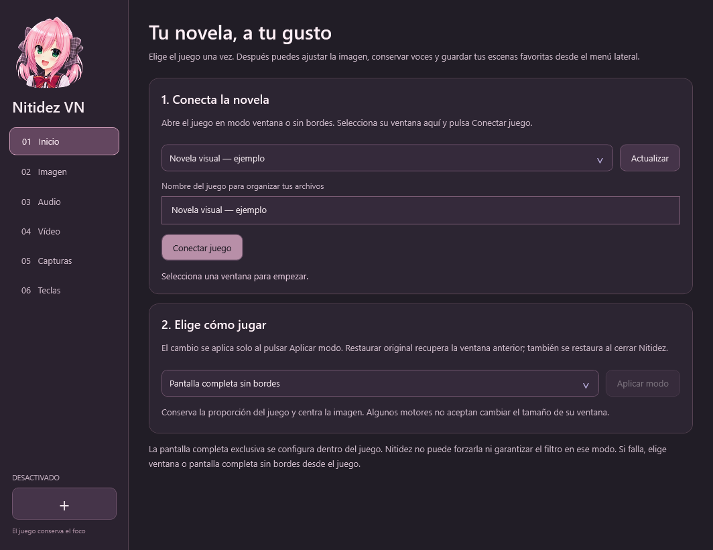
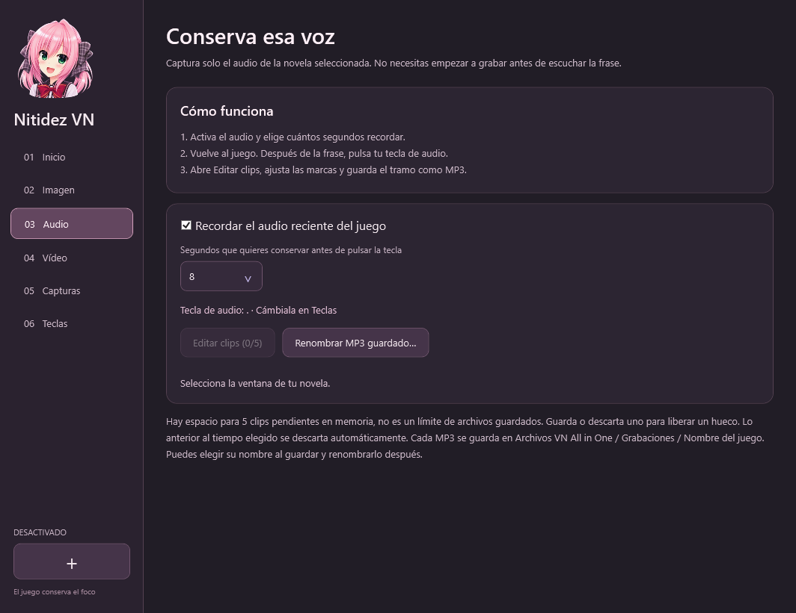
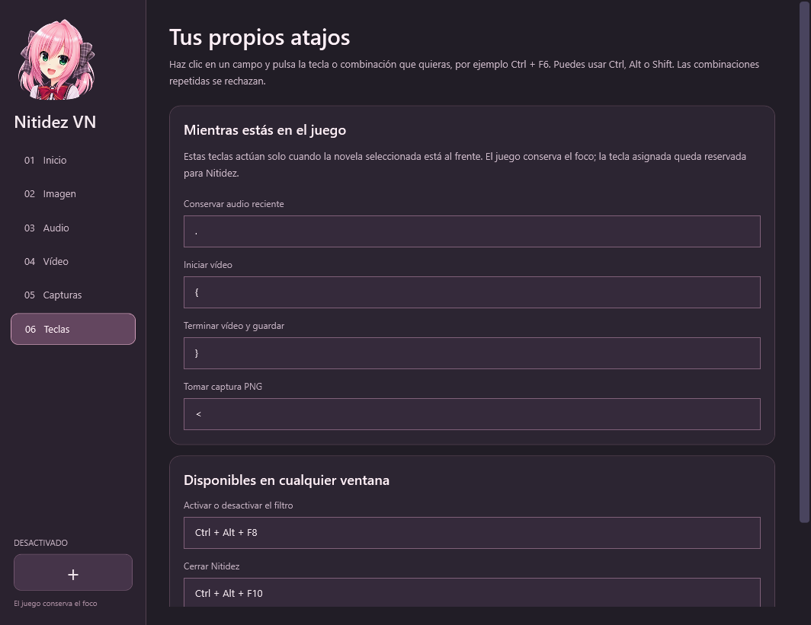

# VN-All-in-One — Nitidez VN 4.1

Herramientas para disfrutar novelas visuales en Windows: filtro de nitidez y color, clips de audio, grabación de vídeo y capturas. Interfaz en español, con menú lateral y una paleta morado/rosa suave.

**Versión 4.1**

[Descargar la versión portable](https://github.com/PaytonN131/VN-All-in-One/releases/tag/v4.1.0)



## Empezar

1. Descarga y extrae **Nitidez VN 4.1.rar** desde Releases. Mantén todos los archivos de la carpeta juntos y abre `NitidezVN.exe`.
2. Abre la novela en **ventana** o **pantalla completa sin bordes**.
3. En **Inicio**, selecciona la ventana y pulsa **Conectar juego**. La última aplicación se recuerda para la próxima sesión.
4. Vuelve al juego. El botón **+** y su atajo activan o desactivan el filtro.

No se instala nada en el juego ni se inyecta código. Los controles de Nitidez se ocultan de la captura del juego. La superposición permite que el juego reciba el ratón y el teclado; las teclas que asignes como atajo quedan reservadas para Nitidez.

## Qué contiene cada panel

| Panel | Para qué sirve |
| --- | --- |
| Inicio | Conectar la novela y aplicar un modo de ventana. |
| Imagen | Estilos, nitidez, brillo, contraste, saturación, temperatura, gamma y rendimiento. |
| Audio | Recordar los últimos segundos de voz y abrir el editor de clips. |
| Vídeo | Grabar MP4 con filtro y audio del juego; revisar, recortar o enviar vídeos a la Papelera. |
| Capturas | Guardar PNG de la novela con los ajustes actuales. |
| Teclas | Asignar una tecla o combinación a cada acción y restaurar los valores originales. |

### Audio

Activa **Recordar el audio reciente** y elige la duración (8 segundos de forma predeterminada). Después de escuchar la frase en el juego, pulsa tu tecla de audio. El clip conserva los segundos anteriores, no empieza a grabar desde ese momento.

Abre **Editar clips**, arrastra las marcas de inicio y final, revisa con **▶** siguiendo la línea de reproducción y guarda el tramo como MP3. Hay hasta **5 clips pendientes en memoria**; puedes guardar tantos archivos como quieras. Guarda o descarta uno para liberar un hueco. El audio anterior al tiempo elegido se descarta automáticamente.



### Vídeo y capturas

Espera una vez a **Captura lista** después de conectar el juego. Inicia y detén el vídeo con tus atajos o el botón del panel. El MP4 toma los ajustes del filtro al iniciar. Los PNG usan los ajustes al pulsar la captura. No se incluye la caja superpuesta de Luna Translator.

Cada **MP4 final pesa hasta 30.000.000 bytes (30 MB)**. Los recortes tampoco superan el tamaño del original. Cuando hace falta más compresión, se realiza al terminar: puede tardar y reducir detalle o resolución. El temporal durante la grabación puede superar 30 MB. Se conservan las proporciones. Los recortes se exportan hasta 720p con H.264 y dos hilos de CPU.

Para movimientos rápidos, prueba 60 FPS. Para reducir el trabajo, usa 720p/30 FPS. La grabación se limita a 30 minutos y se detiene si quedan menos de 256 MiB libres. El filtro GPU está separado de la escritura y la compresión. La captura se prepara al seleccionar el juego; no se garantiza latencia cero.

Los archivos nuevos se guardan por juego. Si no existe la carpeta, se crea automáticamente:

```text
D:\Archivos VN All in One\
├── Capturas\
│   └── Wagamama\
│       ├── Wagamama_01.png
│       └── Wagamama_02.png
├── Grabaciones\
│   └── Wagamama\
│       └── Mi frase favorita.mp3
└── Videos\
    └── Wagamama\
        └── Mi escena favorita.mp4
```

El nombre se propone desde el título de la ventana, quitando sufijos habituales de versión. En **Inicio → Nombre del juego** puedes corregirlo antes de capturar; se recuerda para la última aplicación. Solo se usa el nombre del juego para su subcarpeta, sin PID ni fecha. Los caracteres que Windows no admite se sustituyen.

Las capturas llevan el nombre del juego y un número consecutivo (`Wagamama_01.png`), sin sobrescribir las anteriores. Los MP3 permiten elegir su nombre al guardar. Los botones **Renombrar MP3 guardado…** y **Renombrar MP4…** cambian el nombre del archivo conservando carpeta y extensión; rechazan nombres repetidos o rutas. Cierra la vista previa si mantiene abierto el archivo. Los recortes de un vídeo del programa permanecen en la carpeta de su juego.

Si no existe D:, se usa `Documentos\Archivos VN All in One`. No se mueven ni borran los archivos de la carpeta anterior `D:\Audios_Heroinas`.

### Teclas configurables

Haz clic en el campo y pulsa una tecla o una combinación con Ctrl, Alt o Shift. **Tab** pasa al siguiente campo y **Esc** cancela. No se permiten combinaciones duplicadas. Si otra aplicación ocupa una tecla, el panel lo indica al registrar el atajo. Los ajustes se guardan al cerrar.

| Acción | Atajo original | Cuándo actúa |
| --- | --- | --- |
| Alternar filtro | Ctrl + Alt + F8 | Global |
| Cerrar Nitidez | Ctrl + Alt + F10 | Global |
| Conservar audio | . | Juego seleccionado al frente |
| Iniciar vídeo | { | Juego seleccionado al frente |
| Terminar vídeo | } | Juego seleccionado al frente |
| Captura PNG | < | Juego seleccionado al frente |

Los símbolos originales se adaptan a la distribución del teclado al iniciar. Puedes sustituirlos por combinaciones más cómodas.



### Modos de ventana

El desplegable de Inicio ofrece **Restaurar original**, **Ventana con bordes**, **Ventana sin bordes** y **Pantalla completa sin bordes**. Seleccionar una opción no cambia nada hasta pulsar **Aplicar modo**. Se guarda la geometría anterior para restaurarla al pedirlo, al cambiar de juego o al cerrar Nitidez.

El ajuste conserva la proporción del área del juego, por lo que puede dejar espacio lateral o superior. Algunos motores no aceptan redimensionarse o recrean su ventana: cambia su modo desde las opciones del juego si ocurre. Esto no cambia su resolución interna ni convierte cualquier motor en pantalla exclusiva.

**La pantalla completa exclusiva depende del juego y no se fuerza ni se garantiza su compatibilidad.** Usa ventana o sin bordes para la superposición.

## Requisitos y consumo

- Windows x64 con .NET Framework 4.8 y Windows Graphics Capture. Audio aislado por proceso: Windows 10 build 20348 o posterior; verificado en Windows 10 22H2.
- Direct3D 11 para el filtro y las capturas. La grabación de esta versión requiere **NVIDIA NVENC / h264_nvenc**.
- FFmpeg completo y ffprobe para MP3/MP4. Los PNG y el filtro no requieren FFmpeg. El paquete portable no lo incluye: usa **Preparar FFmpeg.cmd**, FFmpeg Full instalado mediante WinGet/PATH, o coloca `ffmpeg.exe` y `ffprobe.exe` junto al programa. Fuente: https://www.gyan.dev/ffmpeg/builds/ .
- Probado con RTX 2070 SUPER y Windows 10 22H2. No se promete compatibilidad universal, ausencia de latencia ni consumo despreciable. Grabar consume más RAM y GPU que solo filtrar; los fotogramas de grabación pasan por memoria y una cola limitada.

## Compilar

Instala Visual Studio Build Tools con C++ de escritorio y Windows SDK (probado con SDK 10.0.26100). En PowerShell, desde esta carpeta:

```powershell
.\build.ps1 -OutputDirectory .\dist
Copy-Item .\assets .\dist -Recurse -Force
```

La compilación utiliza el compilador de .NET Framework y C++20; produce `NitidezVN.exe`, `WindowCapture.dll` y `PruebaVN.exe` (ventana de prueba). Abre `dist\NitidezVN.exe`. Para exportar audio/vídeo necesitarás FFmpeg según se indica arriba. `Crear acceso escritorio.ps1` crea o actualiza un acceso para el ejecutable de su propia carpeta.

## Verificaciones de 4.1

Se comprobaron carpetas por juego, ocho capturas numeradas concurrentes sin sobrescritura, renombrado de MP3/MP4 conservando extensión y rechazando nombres existentes, captura PNG real desde el botón en su carpeta de juego, nombre de juego corregible, seis paneles a dos tamaños, ausencia de superposición entre menú y botón +, asignación y rechazo de teclas duplicadas, persistencia al reabrir, restauración de atajos, captura dinámica con filtro, audio, recorte y control de tamaño. Los tres modos de ventana se comprobaron en una ventana de prueba conservando su proporción y restaurando la geometría original. Los archivos en `pruebas` permiten repetir las verificaciones con el mismo código.

Esta revisión no se probó dentro de cada novela ni en una segunda PC. La prueba de filtro simultáneo con foco se interrumpió porque Windows no mantuvo la ventana sintética al frente; no se declara esa comprobación como aprobada en esta sesión.

El paquete no contiene ajustes personales, clips ni datos de juegos. El icono rosa procede de los archivos aportados al proyecto; consulta `assets/CREDITOS.md` para su procedencia y limitaciones de atribución.
